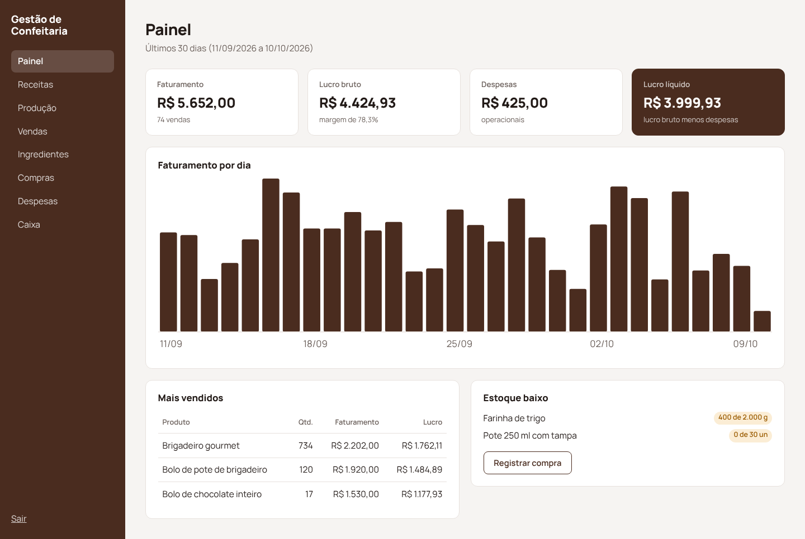
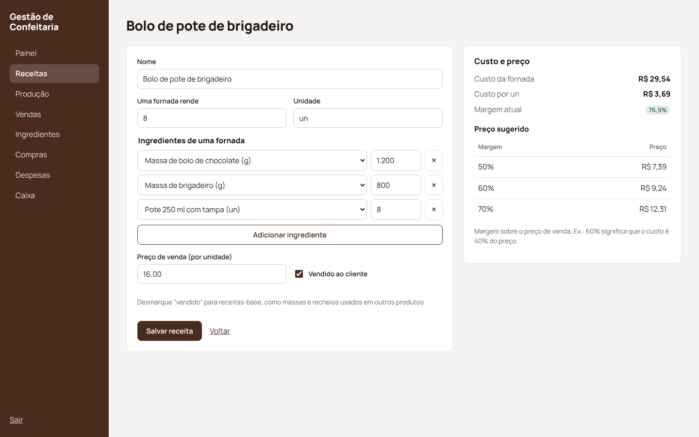
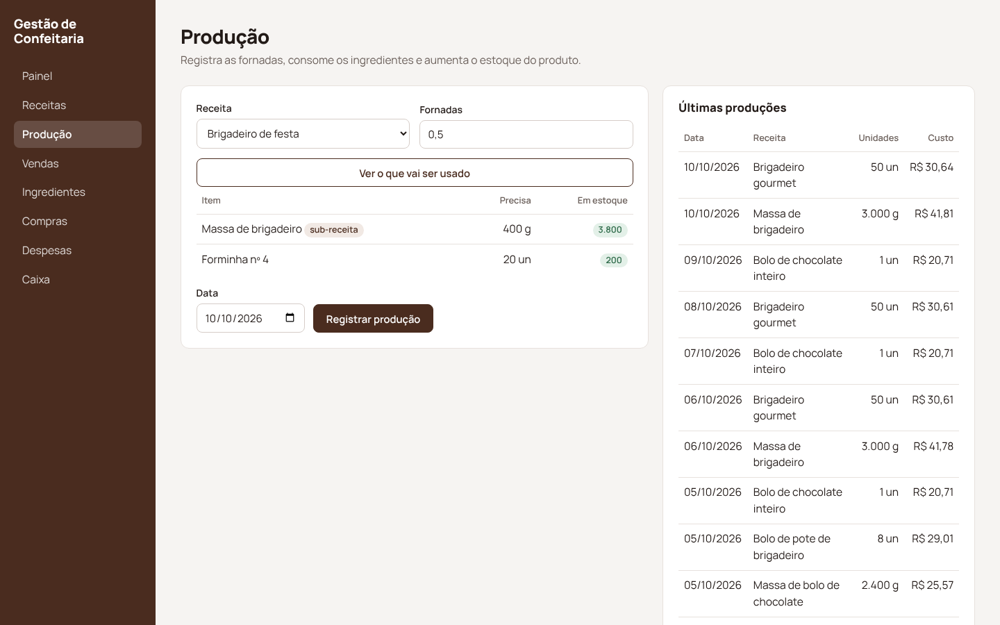
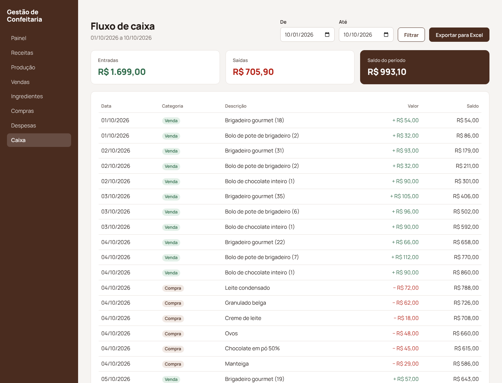

# Gestão de Confeitaria

[](https://github.com/wagnerglongo/gestao-confeitaria/actions/workflows/ci.yml)

Sistema de gestão para confeitarias e docerias: **ficha técnica com custo real de cada doce**, preço sugerido pela margem desejada, controle de produção e estoque, vendas, despesas e fluxo de caixa com exportação para Excel.

Feito em **PHP 8 puro** (sem framework), com as regras de negócio isoladas em classes de domínio e cobertas por testes.

<p align="center"></p>

## O problema que ele resolve

Quem vende doce costuma precificar "de cabeça" e não sabe quanto lucra de verdade. O sistema responde três perguntas:

1. **Quanto custa cada unidade?** Pela receita, usando o custo médio de cada ingrediente nas compras.
2. **Por quanto vender?** O preço sugerido sai da margem desejada, de 50%, 60% ou 70%.
3. **Quanto sobrou no fim do mês?** Pelo faturamento, menos o custo do que foi vendido e as despesas.

<p align="center"></p>

## Funcionalidades

- **Receitas com sub-receitas:** o bolo de pote usa a *massa de bolo* e a *massa de brigadeiro*, que também são receitas. O custo é calculado em cascata.
- **Proteção contra receita circular:** se a massa usar o bolo, que usa a massa, o sistema avisa e não salva.
- **Custo médio ponderado:** cada compra recalcula o custo do ingrediente considerando o que já tinha em estoque.
- **Produção em fornadas:** mostra antes o que vai ser consumido e o que falta, e só registra se tiver tudo.
- **Vendas guardam o custo do momento:** o lucro de cada venda continua correto mesmo que o preço dos ingredientes mude depois.
- **Painel:** faturamento, lucro bruto, margem, lucro líquido, gráfico diário, mais vendidos e alerta de estoque baixo.
- **Fluxo de caixa** por período, com saldo acumulado e **exportação em CSV** que abre certo no Excel em português.

<p align="center"> </p>

## Decisões técnicas

| Tema | O que foi feito |
|---|---|
| Regras de negócio | `RecipeCost` (custo recursivo com memória e detecção de ciclo), `Inventory` (compra, produção e venda) e `Reports` (caixa e indicadores) não dependem de HTML nem de requisição. São testadas direto, com banco SQLite em memória. |
| Consistência | Compra, produção e venda rodam em **transação**. A produção confere o estoque de tudo antes de mexer em qualquer coisa: nunca fica pela metade. |
| Dinheiro | Valores em **centavos inteiros**. Custos unitários (frações de centavo por grama) só são arredondados na hora de exibir ou gravar uma venda. |
| Segurança | Login com `password_hash` e limite de tentativas, token CSRF em todo POST, consultas preparadas, escape de HTML em tudo que vem do banco e *Content-Security-Policy* sem scripts inline. |
| Excel | CSV com `;`, vírgula decimal e BOM UTF-8. Textos que começam com `=`, `+`, `-` ou `@` são neutralizados para não virarem fórmula (*CSV injection*). |
| Banco | Mesmo código com SQLite (desenvolvimento) e MySQL (produção, via Docker Compose). |

## Rodando

```bash
composer install
ADMIN_PASSWORD=sua-senha php bin/setup.php   # cria tabelas, usuário e 30 dias de dados de exemplo
composer serve                               # http://localhost:8000
```

Com Docker e MySQL:

```bash
cp .env.example .env
docker compose up -d --build
docker compose exec app php bin/setup.php    # http://localhost:8080
```

## Testes

```bash
composer test    # 27 testes: custo, ciclos, estoque, transações, caixa, CSV, login e CSRF
```

O GitHub Actions roda os testes e sobe o `docker compose` com MySQL a cada push.

---

Os dados de exemplo são fictícios. Desenvolvido por [Wagner Longo](https://github.com/wagnerglongo).
